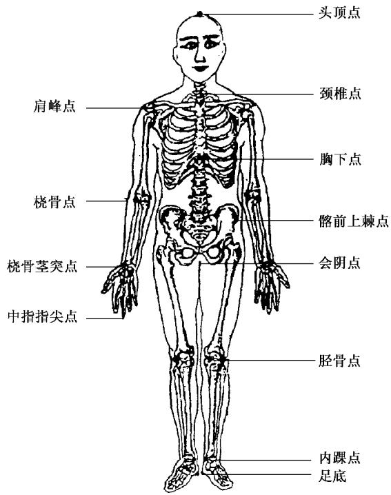
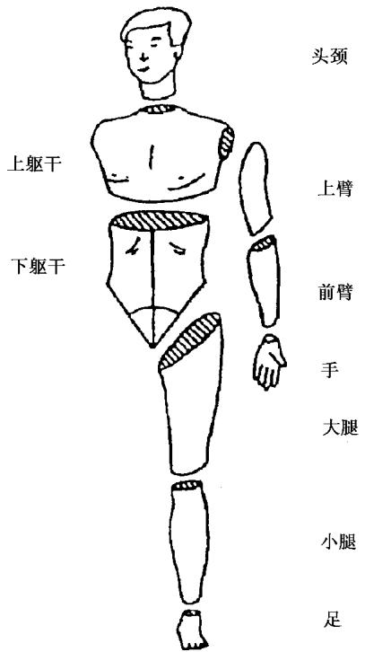
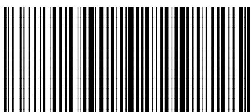

# 成年人人体惯性参数

# Inertial parameters of adult human body

2004-05-10 发布

2004-12-01 实施

# 前言

本标准是GB/T17245—1998《成年人人体质心》的修订版。

本标准代替GB/T17245—1998《成年人人体质心》。

本标准与GB/T17245—1998相比主要变化如下：

将标准名称《成年人人体质心》改为《成年人人体惯性参数》；

——增加了“人体惯性参数、人体环节转动惯量、冠状轴、矢状轴、垂直轴”等术语；

——增加了成年人人体转动惯量的有关内容；

本标准的附录A为规范性附录。

本标准由中国标准研究中心提出。

本标准起草单位：中国标准研究中心、清华大学、北京师范大学。

本标准主要起草人：肖惠、刘静民、滑东红、郑秀瑗、侯曼。

# 引言

人体惯性参数的研究及应用是人类工效学领域有关人体测量生物力学方面重要基础性研究课题。

人体惯性参数包括：人体整体及各体段的质量、质心位置及其转动惯量，是进行人体运动及运动损伤与预防研究的基本参量，也是工效学、人类学及人体科学研究的重要组成部分，有重要的学术价值和实用背景。人体惯性参数的应用领域十分广泛，例如在人体运动影片解析中；体操、技巧、跳水等动作设计；战斗机弹射座椅设计；宇宙飞船专用假人设计和宇航员运动分析；安全设计；工厂厂房及载人器械和设备的护栏设计等均需要此参数。

本标准是在《成年人人体质心》国家标准的基础上又对相应技术成果进行进一步验证后编制而成的，更加充实、完善且更便于在各领域中推广和使用，为科研成果尽快转化为生产力创造了条件，为国民经济发展及社会进步奠定了基础。

# 成年人人体惯性参数

# 1 范围

本标准规定了成年人人体体段划分的方法，给出了成年人人体惯性参数。

本标准适用于安全防护设备(如工业栏杆、民用阳台护栏、安全带等)的设计和形体假人、伤残人假肢的研制。也适用于机动车辆安全保护、检测及飞机应急弹射救生、人体动作分析、运动仿真等方面。

# 2 规范性引用文件

下列文件中的条款通过本标准的引用而成为本标准的条款。凡是注日期的引用文件，其随后所有的修改单(不包括勘误的内容)或修订版均不适用于本标准，然而，鼓励根据本标准达成协议的各方研究是否可使用这些文件的最新版本。凡是不注日期的引用文件，其最新版本适用于本标准。

GB/T5703用于技术设计的人体测量基础项目（eqvISO7250）

# 3 术语和定义

GB/T5703确立的以及下列术语和定义适用于本标准。

3.1

人体惯性参数 inertial parameters of human body

人体质量、质心位置及转动惯量的总称。

3.2

人体体段（人体环段） human-body segment

把人体按骨性标志分割成若干段，每段称人体体段。

3.3

相对质量分布 distribution of relative mass

指每个人体体段的质量占人体总质量的百分比。

3.4

质心相对位置 relative position of mass center

指每个人体体段质心位置相对本体段长度的百分比。

3.5

人体体段转动惯量 rotational inertia of human-body segment

指组成人体体段的各部分质量对指定轴的转动惯量。

3.6

胸下点 substernal point

胸骨体下缘与正中矢状面的交点。

3.7

冠状轴 $(x)$ coronal axis

指在人体呈直立姿势时，通过质心垂直于矢状面的轴，亦称 $x$ 轴，轴正方向向左。

3.8

矢状轴(y) sagittal axis

指在人体呈直立姿势时，人体矢状面上通过质心垂直于脊柱的轴，亦称 $y$ 轴，轴正方向向前。

3.9

垂直轴 $(z)$ vertical axis

指通过质心垂直于冠状轴和矢状轴组成平面的轴，亦称 $z$ 轴，轴正方向向下。

注：当人体姿势改变时，对各人体体段仍然沿用直立姿势的轴系。

# 4 人体体段划分

# 4.1 人体体段分界点

人体体段分界点见表1，人体体段分界点位置见图1。

# 4.2 人体体段划分方法

人体体段划分以明显的骨性标志为分界点，将人体分为头颈、上躯干、下躯干、左上臂、右上臂、左前臂、右前臂、左手、右手、左大腿、右大腿、左小腿、右小腿、左足、右足共15个部位。人体体段划分见图2。

  
图1 人体体段分界点图  
图2 人体体段划分

表 1 人体体段划分分界点  

<table><tr><td rowspan="2">体段</td><td colspan="2">体段分界点</td><td rowspan="2">质心测量起点</td></tr><tr><td>近侧点</td><td>远侧点</td></tr><tr><td>头颈</td><td>头顶点</td><td>颈椎点</td><td>头顶点</td></tr><tr><td>上躯干</td><td>颈椎点</td><td>胸下点</td><td>颈椎点</td></tr><tr><td>下躯干</td><td>胸下点</td><td>会阴点</td><td>胸下点</td></tr><tr><td>大腿</td><td>髂前上棘点</td><td>胫骨点</td><td>胫骨点</td></tr><tr><td>小腿</td><td>胫骨点</td><td>内踝点</td><td>内踝点</td></tr><tr><td>足</td><td>内踝点</td><td>足底</td><td>足底</td></tr><tr><td>上臂</td><td>肩峰点</td><td>桡骨点</td><td>桡骨点</td></tr><tr><td>前臂</td><td>桡骨点</td><td>桡骨茎突点</td><td>桡骨茎突点</td></tr><tr><td>手</td><td>桡骨茎突点</td><td>中指指尖点</td><td>中指指尖点</td></tr><tr><td colspan="4">注:左右对称部分,如上臂、前臂、手、大腿、小腿、足各部位,其体段分界点的名称相同。</td></tr></table>

# 5 人体测量项目及方法

确定成年人人体惯性参数需要测量下列项目：

体重、身高、坐高、颈椎点高、肩高、桡骨点高、桡骨茎突点高、胸下点高、髂前上棘点高、会阴高、胫骨点高、内踝点高、手长、足长、手宽、足宽、头宽、肩宽、胸宽、两髂嵴点间宽、胸厚、头围、颈围、胸围、腰围、臀围、大腿围、小腿围、内踝围、上臂围、前臂围、腕围。

测量方法应符合GB/T5703的规定。

# 6 人体惯性参数

# 6.1 人体惯性参数

# 6.1.1 人体各体段质量、质心位置及整体质心位置的均值与标准差

男子各体段质量、质心位置及整体质心位置的均值与标准差，见表2，女子各体段质量、质心位置及整体质心位置的均值与标准差，见表3。计算男子各体段质量、质心位置及整体质心位置对体重、身高的二元回归方程的系数见表A.1，多元回归方程见表A.3；计算女子各体段质量、质心位置及整体质心位置对体重、身高的二元回归方程的系数见表A.2，多元回归方程见表A.4。

表 2 男子各体段质量、质心位置及整体质心位置的均值与标准差  

<table><tr><td>体段名称</td><td>质量或质心</td><td>均值</td><td>标准差</td></tr><tr><td rowspan="2">头颈</td><td>m</td><td>5.16</td><td>0.21</td></tr><tr><td>m.c</td><td>117.8</td><td>0.4</td></tr><tr><td rowspan="2">上躯干</td><td>m</td><td>10.07</td><td>1.01</td></tr><tr><td>m.c</td><td>115.6</td><td>6.1</td></tr><tr><td rowspan="2">下躯干</td><td>m</td><td>16.30</td><td>2.23</td></tr><tr><td>m.c</td><td>177.8</td><td>6.8</td></tr><tr><td rowspan="2">大腿</td><td>m</td><td>8.50</td><td>0.93</td></tr><tr><td>m.c</td><td>254.5</td><td>11.5</td></tr><tr><td rowspan="2">小腿</td><td>m</td><td>2.20</td><td>0.37</td></tr><tr><td>m.c</td><td>224.1</td><td>12.9</td></tr><tr><td rowspan="2">足</td><td>m</td><td>0.89</td><td>0.12</td></tr><tr><td>m.c</td><td>38.2</td><td>2.0</td></tr><tr><td rowspan="2">上臂</td><td>m</td><td>1.46</td><td>0.18</td></tr><tr><td>m.c</td><td>163.3</td><td>9.2</td></tr><tr><td rowspan="2">前臂</td><td>m</td><td>0.75</td><td>0.10</td></tr><tr><td>m.c</td><td>136.6</td><td>7.4</td></tr><tr><td rowspan="2">手</td><td>m</td><td>0.38</td><td>0.07</td></tr><tr><td>m.c</td><td>114.2</td><td>1.7</td></tr><tr><td rowspan="2">全躯干</td><td>m</td><td>26.37</td><td>3.04</td></tr><tr><td>m.c</td><td>286.2</td><td>14.2</td></tr><tr><td>整体</td><td>m.c</td><td>734.2</td><td>27.2</td></tr><tr><td colspan="4">注1:质心位置(m.c)是由测量起点(见表1)至体段质心的距离确定的。整体质心以头顶点为起点。注2:质量(m)单位为kg,质心(m.c)单位为mm。注3:表中数值为全国成年男子11164人(18岁~60岁)的均值。</td></tr></table>

表 3 女子各体段质量、质心位置及整体质心位置的均值与标准差  

<table><tr><td>体段名称</td><td>质量或质心</td><td>均值</td><td>标准差</td></tr><tr><td rowspan="2">头颈</td><td>m</td><td>4.38</td><td>0.25</td></tr><tr><td>m.c</td><td>111.8</td><td>2.9</td></tr><tr><td rowspan="2">上躯干</td><td>m</td><td>8.73</td><td>1.11</td></tr><tr><td>m.c</td><td>107.4</td><td>6.7</td></tr><tr><td rowspan="2">下躯干</td><td>m</td><td>14.67</td><td>2.69</td></tr><tr><td>m.c</td><td>178.7</td><td>8.7</td></tr><tr><td rowspan="2">大腿</td><td>m</td><td>7.52</td><td>1.17</td></tr><tr><td>m.c</td><td>244.5</td><td>9.4</td></tr><tr><td rowspan="2">小腿</td><td>m</td><td>2.36</td><td>0.37</td></tr><tr><td>m.c</td><td>197.6</td><td>12.2</td></tr><tr><td rowspan="2">足</td><td>m</td><td>0.66</td><td>0.10</td></tr><tr><td>m.c</td><td>36.2</td><td>1.7</td></tr><tr><td rowspan="2">上臂</td><td>m</td><td>1.42</td><td>0.28</td></tr><tr><td>m.c</td><td>151.4</td><td>11.1</td></tr><tr><td rowspan="2">前臂</td><td>m</td><td>0.61</td><td>0.11</td></tr><tr><td>m.c</td><td>124.9</td><td>7.9</td></tr><tr><td rowspan="2">手</td><td>m</td><td>0.22</td><td>0.04</td></tr><tr><td>m.c</td><td>115.0</td><td>3.5</td></tr><tr><td rowspan="2">全躯干</td><td>m</td><td>23.39</td><td>3.64</td></tr><tr><td>m.c</td><td>281.4</td><td>13.6</td></tr><tr><td>整体</td><td>m.c</td><td>698.7</td><td>21.9</td></tr><tr><td colspan="4">注1:质心位置(m.c)是由测量起点(见表1)至体段质心的距离确定的。整体质心是以头顶点为起点。注2:质量(m)单位为kg,质心(m.c)单位为mm。注3:表中数值为全国成年女子11150人(18岁~55岁)的均值。</td></tr></table>

# 6.1.2 人体各体段转动惯量

成年人人体各体段和整体三维转动惯量的均值与标准差见表4、表5。

计算男子人体各体段及整体转动惯量的回归方程见表A.5；计算女子人体各体段及整体转动惯量的回归方程见表A.6。

表 4 男子各体段和整体三维转动惯量的均值与标准差  
单位为千克平方毫米 $(\mathrm{kg} \cdot \mathrm{mm}^2)$   

<table><tr><td>体段名称</td><td>转动惯量</td><td>均值</td><td>标准差</td><td>变异系数</td></tr><tr><td rowspan="3">头颈</td><td>Ix</td><td>32 329</td><td>845</td><td>0.026</td></tr><tr><td>Iy</td><td>33 827</td><td>1 292</td><td>0.038</td></tr><tr><td>Iz</td><td>18 762</td><td>791</td><td>0.042</td></tr><tr><td rowspan="3">上躯干</td><td>Ix</td><td>114 913</td><td>16 845</td><td>0.147</td></tr><tr><td>Iy</td><td>66 578</td><td>10 473</td><td>0.157</td></tr><tr><td>Iz</td><td>107 599</td><td>15 243</td><td>0.142</td></tr><tr><td rowspan="3">下躯干</td><td>Ix</td><td>308 105</td><td>54 904</td><td>0.178</td></tr><tr><td>Iy</td><td>277 666</td><td>46 894</td><td>0.169</td></tr><tr><td>Iz</td><td>123 524</td><td>26 549</td><td>0.215</td></tr><tr><td rowspan="3">大腿</td><td>Ix</td><td>135 388</td><td>18 751</td><td>0.138</td></tr><tr><td>Iy</td><td>137 902</td><td>19 114</td><td>0.139</td></tr><tr><td>Iz</td><td>24 926</td><td>5 603</td><td>0.225</td></tr><tr><td rowspan="3">小腿</td><td>Ix</td><td>21 566</td><td>3 230</td><td>0.150</td></tr><tr><td>Iy</td><td>21 344</td><td>3 182</td><td>0.149</td></tr><tr><td>Iz</td><td>2 412</td><td>651</td><td>0.270</td></tr><tr><td rowspan="3">上臂</td><td>Ix</td><td>11 478</td><td>1 837</td><td>0.160</td></tr><tr><td>Iy</td><td>11 855</td><td>1 995</td><td>0.168</td></tr><tr><td>Iz</td><td>1 552</td><td>72</td><td>0.046</td></tr><tr><td rowspan="3">前臂</td><td>Ix</td><td>2 913</td><td>563</td><td>0.193</td></tr><tr><td>Iy</td><td>2 821</td><td>532</td><td>0.188</td></tr><tr><td>Iz</td><td>738</td><td>180</td><td>0.244</td></tr><tr><td rowspan="3">整体</td><td>Ix</td><td>9 222 809</td><td>1 695 306</td><td>0.183</td></tr><tr><td>Iy</td><td>9 479 466</td><td>1 765 307</td><td>0.186</td></tr><tr><td>Iz</td><td>637 993</td><td>143 725</td><td>0.225</td></tr><tr><td colspan="5">注1:表中提供了通过人体各体段质心的转动惯量,其中Ix为绕冠状轴的转动惯量;Iy为绕矢状轴的转动惯量;Iz为绕垂直轴的转动惯量。注2:变异系数反映数据的离散程度,计算公式为:变异系数=标准差/平均值。注3:表中数值为全国成年男子11 164人(18岁~60岁)的均值。</td></tr></table>

单位为千克平方毫米 $(\mathrm{kg} \cdot \mathrm{mm}^2)$   

<table><tr><td>体段名称</td><td>转动惯量</td><td>均值</td><td>标准差</td><td>变异系数</td></tr><tr><td rowspan="3">头颈</td><td>Ix</td><td>25 830</td><td>1 375</td><td>0.053</td></tr><tr><td>Iy</td><td>25 672</td><td>1 497</td><td>0.058</td></tr><tr><td>Iz</td><td>12 438</td><td>1 505</td><td>0.121</td></tr><tr><td rowspan="3">上躯干</td><td>Ix</td><td>45 073</td><td>8 306</td><td>0.184</td></tr><tr><td>Iy</td><td>70 563</td><td>11 490</td><td>0.163</td></tr><tr><td>Iz</td><td>58 827</td><td>11 624</td><td>0.198</td></tr><tr><td rowspan="3">下躯干</td><td>Ix</td><td>208 697</td><td>34 761</td><td>0.167</td></tr><tr><td>Iy</td><td>218 926</td><td>37 442</td><td>0.171</td></tr><tr><td>Iz</td><td>75 147</td><td>19 329</td><td>0.257</td></tr><tr><td rowspan="3">大腿</td><td>Ix</td><td>102 537</td><td>21 994</td><td>0.214</td></tr><tr><td>Iy</td><td>105 751</td><td>23 942</td><td>0.226</td></tr><tr><td>Iz</td><td>19 832</td><td>6 764</td><td>0.341</td></tr><tr><td rowspan="3">小腿</td><td>Ix</td><td>20 092</td><td>408</td><td>0.203</td></tr><tr><td>Iy</td><td>20 634</td><td>4 155</td><td>0.201</td></tr><tr><td>Iz</td><td>2 407</td><td>568</td><td>0.236</td></tr><tr><td rowspan="3">上臂</td><td>Ix</td><td>9 984</td><td>2 063</td><td>0.207</td></tr><tr><td>Iy</td><td>9 382</td><td>1 885</td><td>0.201</td></tr><tr><td>Iz</td><td>1 423</td><td>387</td><td>0.272</td></tr><tr><td rowspan="3">前臂</td><td>Ix</td><td>2 205</td><td>355</td><td>0.161</td></tr><tr><td>Iy</td><td>2 139</td><td>319</td><td>0.149</td></tr><tr><td>Iz</td><td>489</td><td>61</td><td>0.124</td></tr><tr><td rowspan="3">整体</td><td>Ix</td><td>7 517 344</td><td>1 350 607</td><td>0.179</td></tr><tr><td>Iy</td><td>7 032 832</td><td>1 223 864</td><td>0.174</td></tr><tr><td>Iz</td><td>468 254</td><td>126 309</td><td>0.270</td></tr><tr><td colspan="5">注1:表中提供了通过人体各体段质心的转动惯量,其中Ix为绕冠状轴的转动惯量;Iy为绕矢状轴的转动惯量;Iz为绕垂直轴的转动惯量。注2:变异系数反映数据的离散程度,计算公式为:变异系数=标准差/平均值。注3:表中数值为全国成年女子11 150人(18岁~55岁)的均值</td></tr></table>

# 6.2 人体各体段的相对质量分布

人体各体段的相对质量分布见表6，M表示男子；F表示女子。

示例：头颈的相对质量 $=$ （头颈质量/整体质量） $\times 100\%$

表 6 人体各体段相对质量分布表  

<table><tr><td>体段名称</td><td>性别</td><td>相对质量/%</td><td>体段名称</td><td>性别</td><td>相对质量/%</td></tr><tr><td rowspan="2">头 颈</td><td>M</td><td>8.62</td><td rowspan="2">上 臂</td><td>M</td><td>2.43</td></tr><tr><td>F</td><td>8.20</td><td>F</td><td>2.66</td></tr><tr><td rowspan="2">上躯干</td><td>M</td><td>16.82</td><td rowspan="2">前 臂</td><td>M</td><td>1.25</td></tr><tr><td>F</td><td>16.35</td><td>F</td><td>1.14</td></tr><tr><td rowspan="2">下躯干</td><td>M</td><td>27.23</td><td rowspan="2">手</td><td>M</td><td>0.64</td></tr><tr><td>F</td><td>27.48</td><td>F</td><td>0.42</td></tr><tr><td rowspan="2">大 腿</td><td>M</td><td>14.19</td><td rowspan="2">足</td><td>M</td><td>1.48</td></tr><tr><td>F</td><td>14.10</td><td>F</td><td>1.24</td></tr><tr><td rowspan="2">小 腿</td><td>M</td><td>3.67</td><td rowspan="2" colspan="3"></td></tr><tr><td>F</td><td>4.43</td></tr></table>

# 6.3 人体各体段的质心相对位置

人体各体段的质心相对位置见表7，M表示男子；F表示女子。

示例：头颈的质心相对位置 $=$ （头颈质心至头顶距离/头颈长） $\times 100\%$

大腿的质心相对位置 $=$ （大腿质心至髂前上棘点距离/大腿长） $\times 100\%$

表 7 人体各体段质心相对位置表  

<table><tr><td>体段名称</td><td>性别</td><td>Lcs</td><td>Lcx</td><td>体段名称</td><td>性别</td><td>Lcs</td><td>Lcx</td></tr><tr><td rowspan="2">头 颈</td><td>M</td><td>46.9</td><td>53.1</td><td rowspan="2">上 臂</td><td>M</td><td>47.8</td><td>52.2</td></tr><tr><td>F</td><td>47.3</td><td>52.7</td><td>F</td><td>46.7</td><td>53.3</td></tr><tr><td rowspan="2">上躯干</td><td>M</td><td>53.6</td><td>46.4</td><td rowspan="2">前 臂</td><td>M</td><td>42.4</td><td>57.6</td></tr><tr><td>F</td><td>49.3</td><td>50.7</td><td>F</td><td>45.3</td><td>54.7</td></tr><tr><td rowspan="2">下躯干</td><td>M</td><td>40.3</td><td>59.7</td><td rowspan="2">手</td><td>M</td><td>36.6</td><td>63.4</td></tr><tr><td>F</td><td>44.6</td><td>55.4</td><td>F</td><td>34.9</td><td>65.1</td></tr><tr><td rowspan="2">大 腿</td><td>M</td><td>45.3</td><td>54.7</td><td rowspan="2">足</td><td>M</td><td>48.6</td><td>51.4</td></tr><tr><td>F</td><td>44.2</td><td>55.8</td><td>F</td><td>45.1</td><td>54.9</td></tr><tr><td rowspan="2">小 腿</td><td>M</td><td>39.3</td><td>60.7</td><td rowspan="2">整体质心</td><td>M</td><td>43.8</td><td>56.2</td></tr><tr><td>F</td><td>42.5</td><td>57.5</td><td>F</td><td>44.5</td><td>55.5</td></tr><tr><td colspan="8">注: Lcs指图中各体段质心上部尺寸占本体段全长的百分比。Lcx指图中各体段质心下部尺寸占本体段全长的百分比。</td></tr></table>

# 附录A

# （规范性附录）

# 计算方法

# A.1 计算人体各体段质量、质心位置及整体质心位置的回归方程

# A.1.1 根据体重、身高计算各体段质量、质心位置和整体质心的二元回归方程

根据体重、身高计算男子各体段质量、质心位置和整体质心位置的二元回归方程系数，见表A.1。根据体重、身高计算女子各体段质量、质心位置和整体质心位置的二元回归方程系数，见表A.2。

表 A. 1 男子各体段质量、质心位置和整体质心位置对体重 $\left( {\mathbf{X}}_{1}\right)$ 身高 $\left( {\mathbf{X}}_{2}\right)$ 的二元回归方程系数表  

<table><tr><td>体段名称</td><td>质量或质心Y</td><td>回归方程常数项B0</td><td>体重的回归系数B1</td><td>身高的回归系数B2</td><td>复相关系数R</td></tr><tr><td rowspan="2">头颈</td><td>m</td><td>2.954 0</td><td>0.040 0</td><td>0.000 1</td><td>0.435</td></tr><tr><td>m.c</td><td>69.4000</td><td>0.510 0</td><td>0.013 0</td><td>0.406</td></tr><tr><td rowspan="2">上躯干</td><td>m</td><td>-5.001 0</td><td>0.111 0</td><td>0.005 0</td><td>0.556</td></tr><tr><td>m.c</td><td>-66.650 0</td><td>-0.330 0</td><td>0.121 0</td><td>0.481</td></tr><tr><td rowspan="2">下躯干</td><td>m</td><td>2.286 0</td><td>0.298 0</td><td>-0.002 7</td><td>0.729</td></tr><tr><td>m.c</td><td>40.370 0</td><td>-0.120 0</td><td>0.087 0</td><td>0.435</td></tr><tr><td rowspan="2">大腿</td><td>m</td><td>-0.093 0</td><td>0.152 0</td><td>-0.000 4</td><td>0.756</td></tr><tr><td>m.c</td><td>-122.520 0</td><td>-0.310 0</td><td>0.235 0</td><td>0.808</td></tr><tr><td rowspan="2">小腿</td><td>m</td><td>-0.834 0</td><td>0.061 0</td><td>-0.000 2</td><td>0.735</td></tr><tr><td>m.c</td><td>23.470 0</td><td>0.500 0</td><td>0.095 0</td><td>0.520</td></tr><tr><td rowspan="2">足</td><td>m</td><td>-0.715 0</td><td>0.006 0</td><td>0.000 7</td><td>0.813</td></tr><tr><td>m.c</td><td>35.130 0</td><td>-0.020 0</td><td>0.003 0</td><td>0.377</td></tr><tr><td rowspan="2">上臂</td><td>m</td><td>-0.323 0</td><td>0.030 0</td><td>0.000 1</td><td>0.598</td></tr><tr><td>m.c</td><td>15.150 0</td><td>0.160 0</td><td>0.080 0</td><td>0.507</td></tr><tr><td rowspan="2">前臂</td><td>m</td><td>-0.277 0</td><td>0.016 0</td><td>0.000 1</td><td>0.582</td></tr><tr><td>m.c</td><td>12.940 0</td><td>0.450 0</td><td>0.054 0</td><td>0.514</td></tr><tr><td rowspan="2">手</td><td>m</td><td>-0.424 0</td><td>0.003 0</td><td>0.000 4</td><td>0.780</td></tr><tr><td>m.c</td><td>71.620 0</td><td>0.340 0</td><td>0.013 0</td><td>0.509</td></tr><tr><td>整体</td><td>m.c.</td><td>-32.297 5</td><td>-0.444 3</td><td>0.478 0</td><td>0.833</td></tr><tr><td colspan="6">注:回归方程为:Y=B0+B1X1+B2X2。质量(m)、体重单位为kg,身高单位为mm。质心位置(m.c)是从测量起点(见表1)至体段质心的距离,单位为mm。整体质心起点为头顶点。</td></tr></table>

表 A. 2 女子各体段质量、质心位置和整体质心位置对体重 $\left( {\mathbf{X}}_{1}\right)$ 身高 $\left( {\mathbf{X}}_{2}\right)$ 的二元回归方程系数表  

<table><tr><td>体段名称</td><td>质量或质心Y</td><td>回归方程常数项B0</td><td>体重的回归系数B1</td><td>身高的回归系数B2</td><td>复相关系数R</td></tr><tr><td rowspan="2">头颈</td><td>m</td><td>1.605 0</td><td>0.024 0</td><td>0.000 9</td><td>0.459</td></tr><tr><td>m.c</td><td>64.300 0</td><td>0.320 0</td><td>0.021 0</td><td>0.391</td></tr><tr><td rowspan="2">上躯干</td><td>m</td><td>-9.672 0</td><td>0.113 0</td><td>0.007 7</td><td>0.559</td></tr><tr><td>m.c</td><td>3.890 0</td><td>0.360 0</td><td>0.061 0</td><td>0.540</td></tr><tr><td rowspan="2">下躯干</td><td>m</td><td>-9.440 0</td><td>0.261 0</td><td>0.005 5</td><td>0.790</td></tr><tr><td>m.c</td><td>-87.080 0</td><td>-0.610 0</td><td>0.183 0</td><td>0.642</td></tr><tr><td rowspan="2">大腿</td><td>m</td><td>-3.193 0</td><td>0.145 0</td><td>0.002 2</td><td>0.755</td></tr><tr><td>m.c</td><td>63.700 0</td><td>0.040 0</td><td>0.114 0</td><td>0.390</td></tr><tr><td rowspan="2">小腿</td><td>m</td><td>-2.702 0</td><td>0.042 0</td><td>0.001 8</td><td>0.737</td></tr><tr><td>m.c</td><td>-43.570 0</td><td>0.350 0</td><td>0.141 0</td><td>0.776</td></tr><tr><td rowspan="2">足</td><td>m</td><td>-0.684 0</td><td>0.010 0</td><td>0.000 6</td><td>0.484</td></tr><tr><td>m.c</td><td>-0.590 0</td><td>0.150 0</td><td>0.019 0</td><td>0.448</td></tr><tr><td rowspan="2">上臂</td><td>m</td><td>1.121 0</td><td>0.039 0</td><td>-0.001 1</td><td>0.744</td></tr><tr><td>m.c</td><td>26.710 0</td><td>0.460 0</td><td>0.064 0</td><td>0.418</td></tr><tr><td rowspan="2">前臂</td><td>m</td><td>-0.288 0</td><td>0.014 0</td><td>0.000 1</td><td>0.720</td></tr><tr><td>m.c</td><td>56.780 0</td><td>0.620 0</td><td>0.019 0</td><td>0.498</td></tr><tr><td rowspan="2">手</td><td>m</td><td>-0.003 0</td><td>0.002 0</td><td>0.000 1</td><td>0.249</td></tr><tr><td>m.c</td><td>84.060 0</td><td>0.300 0</td><td>0.009 0</td><td>0.303</td></tr><tr><td>整体</td><td>m.c</td><td>-95.146 7</td><td>-0.545 7</td><td>0.531 1</td><td>0.921</td></tr><tr><td colspan="6">注:回归方程为:Y=B0+B1X1+B2X2。质量(m)、体重单位为kg,身高单位为mm。质心位置(m.c)是从测量起点(见表1)至体段质心的距离,单位为mm。整体质心起点为头顶点。</td></tr></table>

# A. 1.2 根据逐步回归方法计算各体段质量、质心位置及整体质心位置的多元回归方程

根据逐步回归方法计算男子各体段质量、质心位置及整体质心位置的多元回归方程系数、复相关系数，见表A.3。

根据逐步回归方法计算女子各体段质量、质心位置及整体质心位置的多元回归方程系数、复相关系数，见表A.4。

# A.1.3 根据体重、身高计算各体段和整体转动惯量的回归方程

根据体重、身高计算男子各体段和整体转动惯量的二元回归方程系数见表A.5。

根据体重、身高计算女子各体段和整体转动惯量的二元回归方程系数见表A.6。

表 A. 3 男子各体段质量、质心位置及整体质心位置的多元回归方程系数和复相关系数  

<table><tr><td>体段名称</td><td>质量或质心Y</td><td>B0</td><td>B1</td><td>X1</td><td>B2</td><td>X2</td><td>B3</td><td>X3</td><td>B4</td><td>X4</td><td>B5</td><td>X5</td><td>B6</td><td>X6</td><td>B7</td><td>X7</td><td>复相关系数R</td></tr><tr><td rowspan="2">头颈</td><td>m</td><td>-3.4648</td><td>-0.0098</td><td>体重</td><td>0</td><td>身高</td><td>0.0081</td><td>头颈长</td><td>0.0073</td><td>头围</td><td>0.0079</td><td>颈围</td><td>0.0023</td><td>头宽</td><td></td><td></td><td>0.4307</td></tr><tr><td>m.c</td><td>13.4770</td><td>0</td><td>体重</td><td>0</td><td>身高</td><td>0.1480</td><td>头颈长</td><td>0</td><td>头围</td><td>0.2107</td><td>颈围</td><td>-0.0428</td><td>头宽</td><td></td><td></td><td>0.4686</td></tr><tr><td rowspan="2">上躯干</td><td>m</td><td>-8.6388</td><td>0.0218</td><td>体重</td><td>0</td><td>身高</td><td>0.0477</td><td>上躯干长</td><td>0.0104</td><td>胸围</td><td>-0.0230</td><td>胸宽</td><td>0.0216</td><td>胸厚</td><td>0</td><td>坐高</td><td>0.8931</td></tr><tr><td>m.c</td><td>-22.8113</td><td>0.1278</td><td>体重</td><td>0.0540</td><td>身高</td><td>0.5733</td><td>上躯干长</td><td>0.0810</td><td>胸围</td><td>-0.1040</td><td>胸宽</td><td>-0.1274</td><td>胸厚</td><td>-0.1068</td><td>坐高</td><td>0.9814</td></tr><tr><td rowspan="2">下躯干</td><td>m</td><td>-12.9618</td><td>0.1306</td><td>体重</td><td>0</td><td>身高</td><td>0.0277</td><td>下躯干长</td><td>0.0126</td><td>腰围</td><td></td><td></td><td></td><td></td><td></td><td></td><td>0.7751</td></tr><tr><td>m.c</td><td>-58.2118</td><td>-0.5959</td><td>体重</td><td>0.0524</td><td>身高</td><td>0.3149</td><td>下躯干长</td><td>0.0600</td><td>腰围</td><td></td><td></td><td></td><td></td><td></td><td></td><td>0.7644</td></tr><tr><td rowspan="2">大腿</td><td>m</td><td>-8.0760</td><td>0.0561</td><td>体重</td><td>0.0059</td><td>身高</td><td>-0.0045</td><td>大腿长</td><td>0.0062</td><td>臀围</td><td></td><td></td><td></td><td></td><td></td><td></td><td>0.7448</td></tr><tr><td>m.c</td><td>-30.3315</td><td>0</td><td>体重</td><td>0.1322</td><td>身高</td><td>0.2056</td><td>大腿长</td><td>-0.0430</td><td>臀围</td><td></td><td></td><td></td><td></td><td></td><td></td><td>0.8635</td></tr><tr><td rowspan="2">小腿</td><td>m</td><td>-2.9509</td><td>0.0170</td><td>体重</td><td>-0.0013</td><td>身高</td><td>0.0074</td><td>小腿长</td><td>0.0053</td><td>小腿围</td><td>0.0086</td><td>踝上围</td><td></td><td></td><td></td><td></td><td>0.9103</td></tr><tr><td>m.c</td><td>118.1450</td><td>1.1679</td><td>体重</td><td>-0.0608</td><td>身高</td><td>0.5902</td><td>小腿长</td><td>-0.2337</td><td>小腿围</td><td>0</td><td>踝上围</td><td></td><td></td><td></td><td></td><td>0.8861</td></tr><tr><td rowspan="2">足</td><td>m</td><td>-0.4453</td><td>0.0114</td><td>体重</td><td>0.0005</td><td>身高</td><td>-0.0005</td><td>足长</td><td>0.0013</td><td>踝上围</td><td>-0.0031</td><td>足宽</td><td></td><td></td><td></td><td></td><td>0.8542</td></tr><tr><td>m.c</td><td>33.2513</td><td>-0.2788</td><td>体重</td><td>0</td><td>身高</td><td>0.0460</td><td>足长</td><td>0</td><td>踝上围</td><td>0.1126</td><td>足宽</td><td></td><td></td><td></td><td></td><td>0.2257</td></tr><tr><td rowspan="2">上臂</td><td>m</td><td>0.6152</td><td>0.0176</td><td>体重</td><td>-0.0020</td><td>身高</td><td>0.0102</td><td>上臂长</td><td>0</td><td>上臂围</td><td></td><td></td><td></td><td></td><td></td><td></td><td>0.6550</td></tr><tr><td>m.c</td><td>53.2573</td><td>0.2181</td><td>体重</td><td>-0.0610</td><td>身高</td><td>0.7225</td><td>上臂长</td><td>-0.0984</td><td>上臂围</td><td></td><td></td><td></td><td></td><td></td><td></td><td>0.7958</td></tr><tr><td rowspan="2">前臂</td><td>m</td><td>-1.9008</td><td>-0.0057</td><td>体重</td><td>0.0003</td><td>身高</td><td>0.0018</td><td>前臂长</td><td>0.0072</td><td>前臂围</td><td>0.0015</td><td>腕围</td><td></td><td></td><td></td><td></td><td>0.7934</td></tr><tr><td>m.c</td><td>-40.5350</td><td>0</td><td>体重</td><td>0.0621</td><td>身高</td><td>0.3005</td><td>前臂长</td><td>0.3303</td><td>前臂围</td><td>-0.5096</td><td>腕围</td><td></td><td></td><td></td><td></td><td>0.7774</td></tr><tr><td rowspan="2">手</td><td>m</td><td>-0.1286</td><td>0.0070</td><td>体重</td><td>0.0003</td><td>身高</td><td>-0.0004</td><td>手长</td><td>-0.0035</td><td>手宽</td><td></td><td></td><td></td><td></td><td></td><td></td><td>0.8402</td></tr><tr><td>m.c</td><td>73.3278</td><td>0</td><td>体重</td><td>0</td><td>身高</td><td>0.0818</td><td>手长</td><td>0.3216</td><td>手宽</td><td></td><td></td><td></td><td></td><td></td><td></td><td>0.4020</td></tr><tr><td rowspan="2">全躯干</td><td>m</td><td>-13.9300</td><td>0.2012</td><td>体重</td><td>0.0066</td><td>身高</td><td>0.0088</td><td>全躯干长</td><td>0</td><td>胸围</td><td>0.0156</td><td>腰围</td><td>0</td><td>坐高</td><td></td><td></td><td>0.7537</td></tr><tr><td>m.c</td><td>-6.8590</td><td>0</td><td>体重</td><td>0.1033</td><td>身高</td><td>0.3647</td><td>全躯干长</td><td>-0.1493</td><td>胸围</td><td>0.1701</td><td>腰围</td><td>-0.1257</td><td>坐高</td><td></td><td></td><td>0.8252</td></tr><tr><td>整体</td><td>m.c</td><td>192.3712</td><td>1.7425</td><td>体重</td><td>0.3840</td><td>身高</td><td>-0.2384</td><td>腰围</td><td>-0.0246</td><td>臀围</td><td></td><td></td><td></td><td></td><td></td><td></td><td>0.8920</td></tr></table>

注：头颈长=身高一颈椎点高。  
前臂长 $=$ 全臂长一上臂长  
手长 $=$ 上肢长一全臂长  
上躯干长 $=$ （坐高一头颈长） $\times 0.3282$ （当没有胸下点高数据时可用这个公式计算；如果有胸下点高数据则采用公式：上躯干长 $=$ 颈椎点高一胸下点高）  
下躯干长 $=$ 坐高一上躯干  
全躯干长 $=$ 坐高一头颈长  
$Y = B_{0} + B_{1}X_{1} + B_{2}X_{2} + B_{3}X_{3} + B_{4}X_{4} + B_{5}X_{5} + B_{6}X_{6} + B_{7}X_{7}$   
质量 $(m)$ 、体重单位为 $\mathrm{kg}$ ，质心 $(m,c)$ 及人体尺寸单位为 $\mathrm{mm}$ 。

表 A. 4 女子各体段质量、质心位置及整体质心位置的多元回归方程系数和复相关系数  

<table><tr><td>体段名称</td><td>质量或质心Y</td><td>B0</td><td>B1</td><td>X1</td><td>B2</td><td>X2</td><td>B3</td><td>X3</td><td>B4</td><td>X4</td><td>B5</td><td>X5</td><td>B6</td><td>X6</td><td>B7</td><td>X7</td><td>复相关系数R</td></tr><tr><td rowspan="2">头颈</td><td>m</td><td>-3.828 4</td><td>0.009 0</td><td>体重</td><td>0.000 7</td><td>身高</td><td>0.003 9</td><td>头颈长</td><td>0.001 9</td><td>头围</td><td>0.003 8</td><td>颈围</td><td>0.023 3</td><td>头宽</td><td></td><td></td><td>0.663 6</td></tr><tr><td>m.c</td><td>34.491 2</td><td>0.183 5</td><td>体重</td><td>0.020 8</td><td>身高</td><td>0.046 2</td><td>头颈长</td><td>0</td><td>头围</td><td>0.038 2</td><td>颈围</td><td>0.084 6</td><td>头宽</td><td></td><td></td><td>0.436 0</td></tr><tr><td rowspan="2">上躯干</td><td>m</td><td>-0.420 5</td><td>0.117 3</td><td>体重</td><td>0</td><td>身高</td><td>0.024 7</td><td>上躯干长</td><td>0</td><td>胸围</td><td>0</td><td>胸宽</td><td>0.011 2</td><td>胸厚</td><td>-0.004 9</td><td>坐高</td><td>0.873 2</td></tr><tr><td>m.c</td><td>-48.023 7</td><td>0</td><td>体重</td><td>-0.027 3</td><td>身高</td><td>0.600 4</td><td>上躯干长</td><td>0.015 2</td><td>胸围</td><td>-0.055 9</td><td>胸宽</td><td>0.143 8</td><td>胸厚</td><td>0.059 2</td><td>坐高</td><td>0.955 8</td></tr><tr><td rowspan="2">下躯干</td><td>m</td><td>-11.163 3</td><td>0.188 6</td><td>体重</td><td>0</td><td>身高</td><td>0.054 2</td><td>下躯干长</td><td>0.012 9</td><td>腰围</td><td>0.008 5</td><td>两髂棘间宽</td><td>-0.020 9</td><td>坐高</td><td></td><td></td><td>0.895 3</td></tr><tr><td>m.c</td><td>-107.211 0</td><td>-0.838 3</td><td>体重</td><td>0.027 3</td><td>身高</td><td>0.554 5</td><td>下躯干长</td><td>0.050 3</td><td>腰围</td><td>0.078 7</td><td>两髂棘间宽</td><td>0</td><td>坐高</td><td></td><td></td><td>0.881 1</td></tr><tr><td rowspan="2">大腿</td><td>m</td><td>-8.563 0</td><td>0.068 4</td><td>体重</td><td>0</td><td>身高</td><td>0.009 5</td><td>大腿长</td><td>0</td><td>臀围</td><td>0.016 0</td><td>大腿围</td><td></td><td></td><td></td><td></td><td>0.856 8</td></tr><tr><td>m.c</td><td>-69.079 0</td><td>-0.589 4</td><td>体重</td><td>0.096 7</td><td>身高</td><td>0.185 2</td><td>大腿长</td><td>0.120 5</td><td>臀围</td><td>0</td><td>大腿围</td><td></td><td></td><td></td><td></td><td>0.789 3</td></tr><tr><td rowspan="2">小腿</td><td>m</td><td>-2.262 6</td><td>0.024 3</td><td>体重</td><td>-0.001 8</td><td>身高</td><td>0.010 9</td><td>小腿长</td><td>0.002 7</td><td>小腿围</td><td>0.007 6</td><td>踝上围</td><td></td><td></td><td></td><td></td><td>0.866 7</td></tr><tr><td>m.c</td><td>42.772 5</td><td>-1.099 3</td><td>体重</td><td>0</td><td>身高</td><td>0.625 0</td><td>小腿长</td><td>0.237 9</td><td>小腿围</td><td>-0.394 2</td><td>踝上围</td><td></td><td></td><td></td><td></td><td>0.528 7</td></tr><tr><td rowspan="2">足</td><td>m</td><td>-1.289 2</td><td>0</td><td>体重</td><td>0</td><td>身高</td><td>0.002 3</td><td>足长</td><td>0.007 1</td><td>踝上围</td><td>0</td><td>足宽</td><td></td><td></td><td></td><td></td><td>0.643 1</td></tr><tr><td>m.c</td><td>-13.532 8</td><td>0</td><td>体重</td><td>0.018 2</td><td>身高</td><td>0</td><td>足长</td><td>0.070 0</td><td>踝上围</td><td>0.080 5</td><td>足宽</td><td></td><td></td><td></td><td></td><td>0.491 8</td></tr><tr><td rowspan="2">上臂</td><td>m</td><td>-2.054 4</td><td>0.008 5</td><td>体重</td><td>-0.000 9</td><td>身高</td><td>0.009 1</td><td>上臂长</td><td>0.007 4</td><td>上臂围</td><td></td><td></td><td></td><td></td><td></td><td></td><td>0.847 5</td></tr><tr><td>m.c</td><td>-104.494</td><td>-0.808 9</td><td>体重</td><td>0</td><td>身高</td><td>0.865 2</td><td>上臂长</td><td>0.204 1</td><td>上臂围</td><td></td><td></td><td></td><td></td><td></td><td></td><td>0.725 2</td></tr><tr><td rowspan="2">前臂</td><td>m</td><td>-1.458 6</td><td>0</td><td>体重</td><td>0</td><td>身高</td><td>0.002 4</td><td>前臂长</td><td>0.004 3</td><td>前臂围</td><td>0.004 1</td><td>腕围</td><td></td><td></td><td></td><td></td><td>0.847 7</td></tr><tr><td>m.c</td><td>-14.604 5</td><td>0</td><td>体重</td><td>-0.010 4</td><td>身高</td><td>0.640 0</td><td>前臂长</td><td>0.164 8</td><td>前臂围</td><td>-0.122 5</td><td>腕围</td><td></td><td></td><td></td><td></td><td>0.961 4</td></tr><tr><td rowspan="2">手</td><td>m</td><td>-0.486 9</td><td>0</td><td>体重</td><td>0</td><td>身高</td><td>0.003 6</td><td>手长</td><td>0.002 0</td><td>手宽</td><td></td><td></td><td></td><td></td><td></td><td></td><td>0.672 9</td></tr><tr><td>m.c</td><td>31.197 7</td><td>0</td><td>体重</td><td>0</td><td>身高</td><td>0.402 8</td><td>手长</td><td>0.204 3</td><td>手宽</td><td></td><td></td><td></td><td></td><td></td><td></td><td>0.640 9</td></tr><tr><td rowspan="2">全躯干</td><td>m</td><td>-21.445 6</td><td>0.258 3</td><td>体重</td><td>0.005 3</td><td>身高</td><td>0.028 6</td><td>全躯干长</td><td>0.008 4</td><td>胸围</td><td>0.012 9</td><td>腰围</td><td>-0.012 4</td><td>坐高</td><td></td><td></td><td>0.878 4</td></tr><tr><td>m.c</td><td>-138.061 0</td><td>-0.453 1</td><td>体重</td><td>0.052 6</td><td>身高</td><td>0.383 6</td><td>全躯干长</td><td>0.033 0</td><td>胸围</td><td>0.064 5</td><td>腰围</td><td>0.060 6</td><td>坐高</td><td></td><td></td><td>0.943 9</td></tr><tr><td>整体</td><td>m.c</td><td>-186.860 9</td><td>-1.209 3</td><td>体重</td><td>0.532 9</td><td>身高</td><td>0.136 5</td><td>臂围</td><td></td><td></td><td></td><td></td><td></td><td></td><td></td><td></td><td>0.930</td></tr><tr><td colspan="18">注:头颈长=身高-颈椎点高
    前臂长=全臂长-上臂长
    手长=上肢长-全臂长
    上躯干长=(坐高一头颈长)×0.328 2(当没有胸下点高数据时可用这个公式计算;如果有胸下点高数据则采用公式:上躯干长=颈椎点高一胸下点高)
    下躯干长=坐高-上躯干长-头颈长
    全躯干长=坐高-头颈长
    Y=B0+B1X1+B2X2+B3X3+B4X4+B5X5+B6X6+B7X7
    质量(m)、体重单位为kg,质心(m.c)及人体尺寸单位为mm。</td></tr></table>

表 A. 5 男子各体段及整体转动惯量对体重 $\left( {\mathbf{X}}_{1}\right)$ 、身高 $\left( {\mathbf{X}}_{2}\right)$ 的二元回归方程系数表  

<table><tr><td>体段</td><td>转动惯量</td><td>回归方程常数项\(B_0\)</td><td>体重的回归系数\(B_1\)</td><td>身高的回归系数\(B_2\)</td><td>复相关系数\(R\)</td></tr><tr><td rowspan="3">头颈</td><td>\(I_x\)</td><td>27 149.4</td><td>-115.8</td><td>7.22</td><td>0.126</td></tr><tr><td>\(I_y\)</td><td>25 082.1</td><td>-177.3</td><td>11.54</td><td>0.197</td></tr><tr><td>\(I_z\)</td><td>18 641.0</td><td>-105.0</td><td>3.82</td><td>0.190</td></tr><tr><td rowspan="3">上躯干</td><td>\(I_x\)</td><td>-234 173.2</td><td>1 181.0</td><td>165.88</td><td>0.550</td></tr><tr><td>\(I_y\)</td><td>-143 387.9</td><td>772.6</td><td>97.55</td><td>0.518</td></tr><tr><td>\(I_z\)</td><td>-51 335.7</td><td>1 702.4</td><td>33.95</td><td>0.475</td></tr><tr><td rowspan="3">下躯干</td><td>\(I_x\)</td><td>-187 498.0</td><td>6 343.1</td><td>68.94</td><td>0.545</td></tr><tr><td>\(I_y\)</td><td>-174 836.1</td><td>5 339.4</td><td>79.08</td><td>0.505</td></tr><tr><td>\(I_z\)</td><td>69 927.7</td><td>3 448.5</td><td>-91.15</td><td>0.659</td></tr><tr><td rowspan="3">大腿</td><td>\(I_x\)</td><td>-370 537.7</td><td>428.4</td><td>286.21</td><td>0.834</td></tr><tr><td>\(I_y\)</td><td>-366 488.9</td><td>554.9</td><td>280.78</td><td>0.831</td></tr><tr><td>\(I_z\)</td><td>6 527.0</td><td>716.5</td><td>-14.61</td><td>0.674</td></tr><tr><td rowspan="3">小腿</td><td>\(I_x\)</td><td>-30 104.4</td><td>299.0</td><td>20.12</td><td>0.461</td></tr><tr><td>\(I_y\)</td><td>-29 916.4</td><td>293.0</td><td>20.09</td><td>0.459</td></tr><tr><td>\(I_z\)</td><td>-1 777.6</td><td>79.2</td><td>-0.33</td><td>0.615</td></tr><tr><td rowspan="3">上臂</td><td>\(I_x\)</td><td>-18 962.4</td><td>165.6</td><td>12.23</td><td>0.525</td></tr><tr><td>\(I_y\)</td><td>-20 439.4</td><td>183.1</td><td>12.71</td><td>0.552</td></tr><tr><td>\(I_z\)</td><td>-195.3</td><td>3.4</td><td>0.92</td><td>0.237</td></tr><tr><td rowspan="3">前臂</td><td>\(I_x\)</td><td>-8 113.5</td><td>42.9</td><td>5.04</td><td>0.677</td></tr><tr><td>\(I_y\)</td><td>-7 438.3</td><td>41.3</td><td>4.64</td><td>0.648</td></tr><tr><td>\(I_z\)</td><td>-627.9</td><td>21.4</td><td>0.05</td><td>0.474</td></tr><tr><td rowspan="3">整体</td><td>\(I_x\)</td><td>-27 319 232.8</td><td>116 892.8</td><td>17 786.9</td><td>0.935</td></tr><tr><td>\(I_y\)</td><td>-25 397 472.8</td><td>130 503.9</td><td>16 396.1</td><td>0.971</td></tr><tr><td>\(I_z\)</td><td>-290 702.3</td><td>17 514.8</td><td>-71.82</td><td>0.988</td></tr><tr><td colspan="6">注1:回归方程为:\(I_i=B_0+B_1X_1+B_2X_2(i=x,y,z),X_1\)单位为kg,\(X_2\)单位为mm。注2:计算整体转动惯量时手、足按质点计算。注3:表中提供了通过人体各体段质心的转动惯量,单位为kg·mm²。其中\(I_x\)为绕冠状轴的转动惯量;\(I_y\)为绕矢状轴的转动惯量;\(I_z\)为绕垂直轴的转动惯量。</td></tr></table>

表 A. 6 女子各体段及整体转动惯量对体重 $\left( {\mathbf{X}}_{1}\right)$ 、身高 $\left( {\mathbf{X}}_{2}\right)$ 的二元回归方程系数表  

<table><tr><td>体段</td><td>转动惯量</td><td>回归方程常数项 B0</td><td>体重的回归系数 B1</td><td>身高的回归系数 B2</td><td>复相关系数 R</td></tr><tr><td rowspan="3">头颈</td><td>Ix</td><td>-6 631.2</td><td>92.1</td><td>17.59</td><td>0.465</td></tr><tr><td>Iy</td><td>-1 495.3</td><td>145.8</td><td>12.43</td><td>0.411</td></tr><tr><td>Iz</td><td>16 474.9</td><td>214.8</td><td>-9.73</td><td>0.506</td></tr><tr><td>体段</td><td>转动惯量</td><td>回归方程常数项\(B_0\)</td><td>体重的回归系数\(B_1\)</td><td>身高的回归系数\(B_2\)</td><td>复相关系数\(R\)</td></tr><tr><td rowspan="3">上躯干</td><td>\(I_x\)</td><td>-64 145.9</td><td>964.9</td><td>37.34</td><td>0.738</td></tr><tr><td>\(I_y\)</td><td>-87 546.5</td><td>1 312.1</td><td>56.88</td><td>0.765</td></tr><tr><td>\(I_z\)</td><td>-21 512.5</td><td>1 533.5</td><td>0</td><td>0.777</td></tr><tr><td rowspan="3">下躯干</td><td>\(I_x\)</td><td>160 819.0</td><td>4 869.9</td><td>-131.91</td><td>0.546</td></tr><tr><td>\(I_y\)</td><td>234 318.0</td><td>5 304.5</td><td>-186.66</td><td>0.575</td></tr><tr><td>\(I_z\)</td><td>15 843.4</td><td>2 670.1</td><td>-51.3</td><td>0.762</td></tr><tr><td rowspan="3">大腿</td><td>\(I_x\)</td><td>-192 693.4</td><td>2 537.4</td><td>103.31</td><td>0.926</td></tr><tr><td>\(I_y\)</td><td>-162 226.5</td><td>2 920.0</td><td>73.21</td><td>0.908</td></tr><tr><td>\(I_z\)</td><td>19 736.3</td><td>954.8</td><td>-31.77</td><td>0.626</td></tr><tr><td rowspan="3">小腿</td><td>\(I_x\)</td><td>-62 188.5</td><td>357.8</td><td>40.44</td><td>0.825</td></tr><tr><td>\(I_y\)</td><td>-58 860.9</td><td>385.9</td><td>37.73</td><td>0.811</td></tr><tr><td>\(I_z\)</td><td>-1 516.6</td><td>74.9</td><td>0</td><td>0.612</td></tr><tr><td rowspan="3">上臂</td><td>\(I_x\)</td><td>-14 768.9</td><td>247.0</td><td>7.52</td><td>0.748</td></tr><tr><td>\(I_y\)</td><td>-15 556.3</td><td>218.7</td><td>8.58</td><td>0.751</td></tr><tr><td>\(I_z\)</td><td>-1 254.1</td><td>51.1</td><td>0</td><td>0.695</td></tr><tr><td rowspan="3">前臂</td><td>\(I_x\)</td><td>-7 242.9</td><td>14.8</td><td>5.52</td><td>0.729</td></tr><tr><td>\(I_y\)</td><td>-6 308.8</td><td>13.7</td><td>4.92</td><td>0.686</td></tr><tr><td>\(I_z\)</td><td>-1 286.7</td><td>0</td><td>1.13</td><td>0.380</td></tr><tr><td rowspan="3">整体</td><td>\(I_x\)</td><td>-17 803 583.7</td><td>119 576.60</td><td>11 939.0</td><td>0.952</td></tr><tr><td>\(I_y\)</td><td>-17 309 877.5</td><td>129 946.20</td><td>11 468.6</td><td>0.964</td></tr><tr><td>\(I_z\)</td><td>-241 653.3</td><td>16 962.25</td><td>-113.756</td><td>0.978</td></tr><tr><td colspan="6">注1:回归方程为:\(I_i=B_0+B_1X_1+B_2X_2(i=x,y,z),X_1\)单位为kg,\(X_2\)单位为mm。注2:计算整体转动惯量时手、足按质点计算。注3:表中提供了通过人体各体段质心的转动惯量,单位为kg·mm²。其中\(I_x\)为绕冠状轴的转动惯量;\(I_y\)为绕矢状轴的转动惯量;\(I_z\)为绕垂直轴的转动惯量。</td></tr></table>

GB/T 17245-2004

中华人民共和国

国家标准

成年人人体惯性参数

GB/T17245—2004

￥

中国标准出版社出版发行

北京西城区复兴门外三里河北街16号

邮政编码：100045

http://www.bzcbs.com

电话：63787337、63787447

2004年9月第一版 2004年12月电子版制作

关

书号：155066·1-21625

版权专有 侵权必究

举报电话：（010）68533533